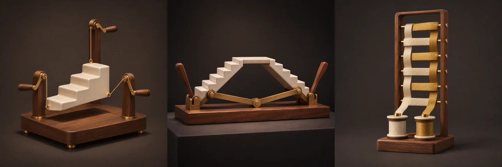

# KlarUp and mutual accountability

Read each at aisle distance. The desired first impression is that people help one another follow through. These generated images compare silhouettes before modeling.

| Study | A detail to look for when rotating | Question for the first visitor |
| --- | --- | --- |
| 1. Shared lift | Three cords terminate on the same staircase. | What happens if one person lets go? |
| 2. Reciprocal bridge | The brass link joins the levers underneath the bridge. | What do the two sides do for each other? |
| 3. Check-in loom | Each spool contributes to successive rungs. | Where can you see each partner’s contribution? |

After Emeka chooses a direction, test the silhouette in the case on a phone and verify its meaning with a first-time visitor before finishing the reverse and underside.
