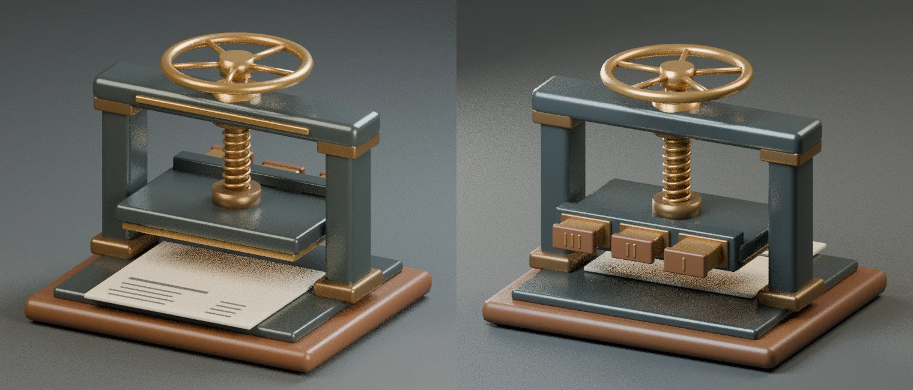

# Verafin report press

The front represents the reporting work. Turning the press around reveals three removable modules representing the plugins that extend reporting. The sheet uses abstract marks. The wheel, screw and platen give the visitor a continuous silhouette to follow between views.

Open the [editable 3D study](report-press.glb) in a glTF viewer to inspect it from any angle. The [current exhibit](../verafin.md) is the comparison point.

## Review at phone size

Start with the front three-quarter view so the sheet clears the front pillar. Rotate to the reverse and see whether a visitor can identify the three cartridges without a caption. The brass handles and screw compete for attention at small sizes. If visitors miss the cartridges, extend one farther and give its socket a lighter rim before adapting the study for the museum.
